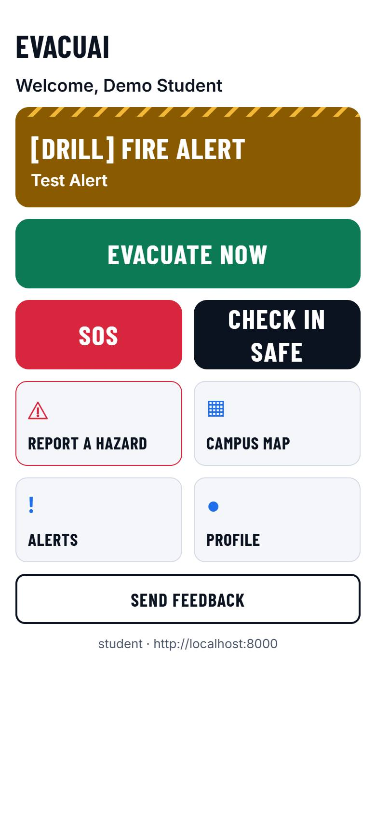
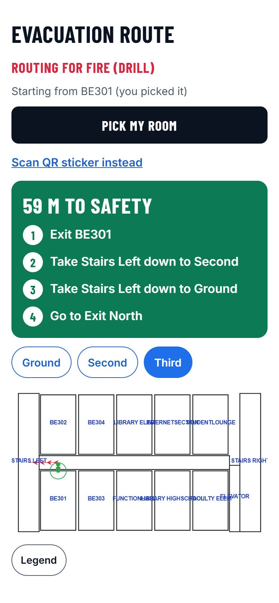
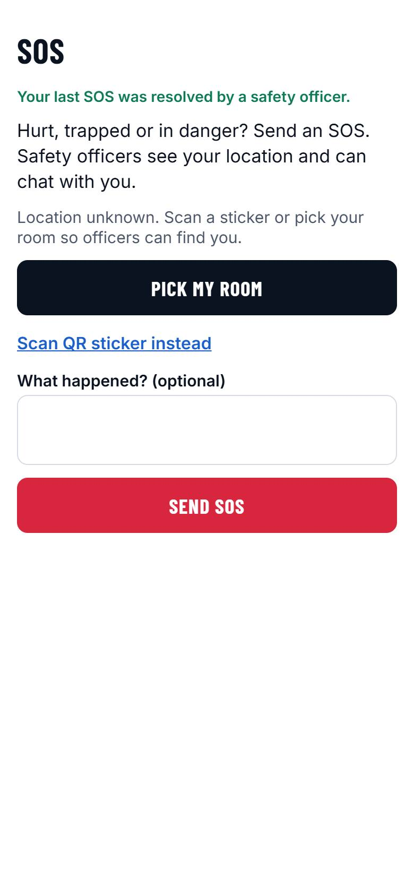
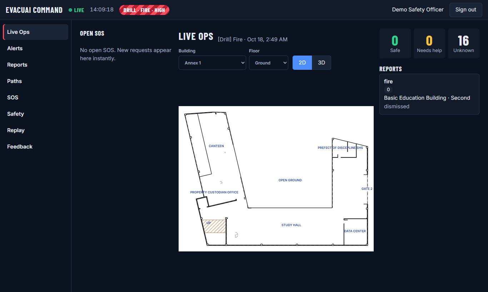
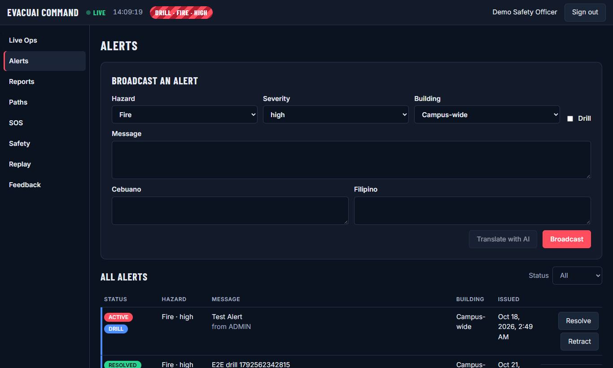
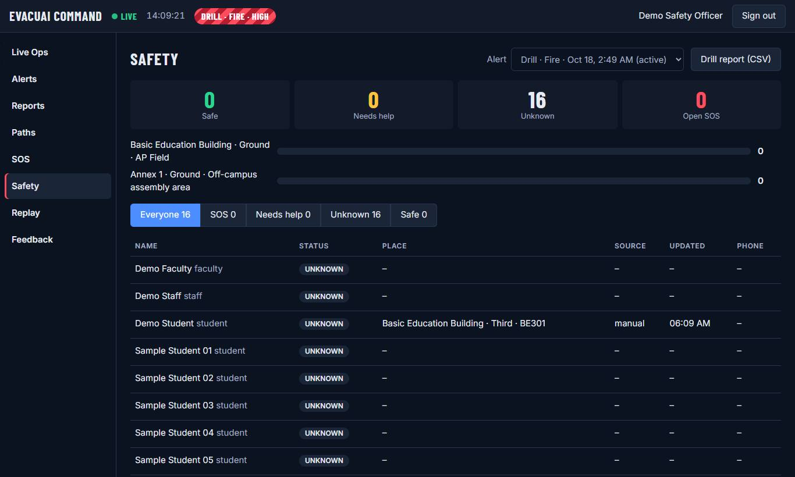
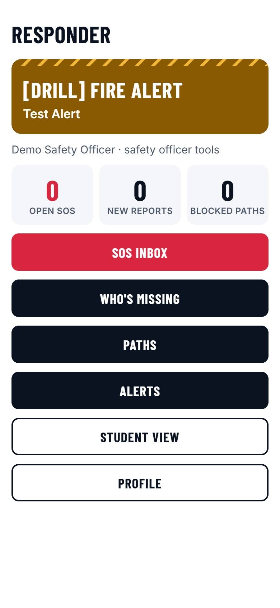
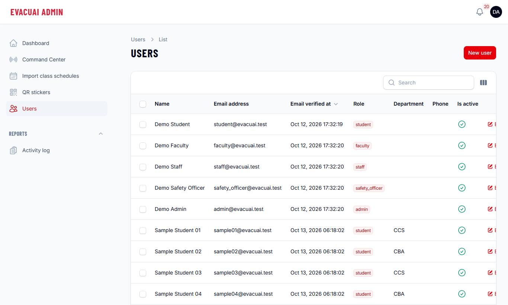

# EvacuAI Walkthrough and Test Scenarios

This walkthrough takes you through every part of EvacuAI, one role at a time, as a set of test scenarios. Each scenario
has **Steps** to follow and an **Expected result** with check boxes: tick a box when you see that result. If something
is different, write it in the [results table](#7-results) at the end.

Before you start, EvacuAI must be running on your computer (see the [Setup Guide](SETUP-GUIDE.md)).

1. [Before you start](#1-before-you-start)
2. [Student: the EvacuAI app](#2-student-the-evacuai-app)
3. [Safety officer: the Command Center](#3-safety-officer-the-command-center)
4. [Safety officer on the phone: Responder mode](#4-safety-officer-on-the-phone-responder-mode)
5. [Admin: the Admin panel](#5-admin-the-admin-panel)
6. [Full drills, start to finish](#6-full-drills-start-to-finish)
7. [Results](#7-results)

---

## 1. Before you start

**Use two browser windows side by side**, so you can watch one role react to the other:

| Window | Address | Sign in as |
|---|---|---|
| Left: the app (phone view: press F12, then the phone icon) | http://localhost:8081 | `student@evacuai.test` |
| Right: the Command Center | http://localhost:8000/command | `safety_officer@evacuai.test` |

The password of every demo account is **`evacuai-demo`**. Use a **private/incognito window** when you need a second
person in the app at the same time (each window keeps its own sign-in).

**Drills are practice.** Always tick **Drill** when you broadcast a test alert, so everyone can tell it is not real.
Resolve your drills when you finish a scenario, so the next one starts clean.

**Colours mean the same everywhere** (like the safety signs on campus): red is danger and SOS, green is the way out and
safe, amber is a warning or a drill, and blue is information.

---

## 2. Student: the EvacuAI app



### S1. Create an account

**Steps**

1. Open http://localhost:8081 and tap **Create an account**.
2. Enter your full name, an email (any address, for example `juan.test@example.com`) and a password of 8 characters or
   more, twice. Tap **Create account**.
3. Open the test mailbox at http://localhost:8025, open the newest email and copy the 6-digit code.
4. Back in the app, enter the code and tap **Verify**.
5. Read the privacy notice and tap **I agree**.

**Expected result**

- [ ] The code email arrives in the test mailbox within seconds.
- [ ] After **I agree**, the home screen says **Welcome, <your name>**.
- [ ] With no alert active, the home shows a green **All clear** card.

### S2. Sign in, sign out, forgot password

**Steps**

1. Tap **Profile**, then **Sign out**.
2. Sign in as `student@evacuai.test` / `evacuai-demo`.
3. Sign out again, tap **Forgot password?**, enter the email of the account from S1, read the code at
   http://localhost:8025 and set a new password. Sign in with it.

**Expected result**

- [ ] Signing in opens the home screen.
- [ ] A wrong password shows an error and does not sign in.
- [ ] The new password works; the old one no longer does.

### S3. Find the way out (no alert)

**Steps**

1. Sign in as `student@evacuai.test`. Tap **Evacuation route**.
2. Under **What is happening?** choose **Fire**.
3. Tap **Pick my room**, then **Basic Education Building**, **Third**, **BE301**.
4. Read the steps. Tap the floor buttons (**Ground**, **Second**, **Third**) under the steps.
5. Go back, pick **Annex 1**, a floor and a room, and look at its route.

**Expected result**

- [ ] A green panel shows **"… m to safety"** and numbered steps such as "Exit BE301" and "Take Stairs Left down to …".
- [ ] The floor plan shows red arrows along the route and a green figure where you are.
- [ ] Annex 1 is drawn like the official evacuation posters (walls, doors, stairs, blue room names), and the route
      ends with an **Exit to …** badge.



### S4. Campus map

**Steps**

1. Go home and tap **Campus map**. Choose a building.
2. Switch between **Floor plan**, **All floors** and **3D**. In 3D, drag to turn and scroll or pinch to zoom.
3. On **Floor plan**, tap **Legend**.

**Expected result**

- [ ] **Floor plan** shows one floor; **All floors** stacks every floor with the ground floor at the bottom.
- [ ] **3D** shows the walls on stacked floors (on a phone, only if it has enough memory).
- [ ] The legend explains the route arrows, your location, blocked and congested paths and stairs.

### S5. Report a hazard with a photo

**Steps**

1. Go home and tap **Report a hazard**.
2. Under **What is it?** choose **Fire**. Choose the building and floor, and optionally a room.
3. Under **What do you see?** write "Smoke coming from the hallway".
4. Add a photo with **Choose photo** (on a phone also **Take photo**). Tap **Send report**.
5. In the Command Center window, open **Reports**.

**Expected result**

- [ ] The app says **Report sent. Safety officers have been notified.**
- [ ] The report appears in the Command Center **Reports** list within seconds, with **View photo**.

### S6. Send an SOS and chat with an officer

**Steps**

1. In the app, tap the red **SOS** button.
2. Tap **Pick my room** and choose your room. Under **What happened? (optional)** write "Twisted ankle".
3. Tap **Send SOS**.
4. In the Command Center, open **SOS**, click the request, click **Acknowledge** and reply "Stay where you are, we are
   coming." with **Send**.
5. In the app, reply "Thank you" with **Send message**.
6. In the Command Center, click **Resolve** and confirm.

**Expected result**

- [ ] The app shows **Waiting for a safety officer…**, then **<officer> is responding** after Acknowledge.
- [ ] Messages appear on the other side within seconds, without refreshing.
- [ ] The Command Center's **SOS** menu shows a red count while the SOS is open.
- [ ] After Resolve, the app says your last SOS was resolved.



### S7. Alerts and check-in (needs an active drill)

**Steps**

1. In the Command Center, open **Alerts**. Choose **Fire**, severity **high**, tick **Drill**, write the message "Fire
   drill. Leave the building by the nearest stairs." and click **Broadcast**.
2. Watch the app's home screen.
3. In the app, tap **EVACUATE NOW**, then go back and tap **Check in safe**. Choose
   **I'm safe (not at an assembly point)** (on a phone near an assembly point, **Check in safe at …** or
   **Scan assembly point QR**).
4. Tap **Alerts** on the home screen.

**Expected result**

- [ ] Within seconds, the app shows an amber striped **[DRILL] FIRE ALERT** band, without refreshing.
- [ ] The home then leads with a big green **EVACUATE NOW** button, with **SOS** and **Check in safe** under it.
- [ ] **EVACUATE NOW** opens the evacuation route already set for fire.
- [ ] Check-in confirms **You checked in safe.**
- [ ] **Alerts** lists the drill as active.

Leave the drill active for section 3, or resolve it in the Command Center (**Alerts → Resolve**).

### S8. Feedback, profile and dark mode

**Steps**

1. Tap **Send feedback**, choose a rating, add a comment and tap **Send feedback**.
2. Tap **Profile**: change your department and tap **Save profile**.
3. Switch your phone or computer to **dark mode** (Windows: Settings → Personalization → Colors → Dark).

**Expected result**

- [ ] The feedback shows up in the Command Center **Feedback** page.
- [ ] The profile change is kept after signing out and in again.
- [ ] The app switches to dark colours and stays easy to read.

---

## 3. Safety officer: the Command Center

Open http://localhost:8000/command. It is a dark control-room screen: the top bar shows **LIVE** (green) while updates
arrive instantly, the time, and the active alert. The menu on the left opens each tool.



### O1. Sign in, and only officers get in

**Steps**

1. Sign in as `student@evacuai.test`.
2. Sign in as `safety_officer@evacuai.test`.

**Expected result**

- [ ] The student is refused: "Those details don't match an officer account."
- [ ] The officer opens on **Live Ops**, and the top bar shows **LIVE**.

### O2. Live Ops

**Steps**

1. Choose **Annex 1** and a floor, then the other building. Click **3D**, then **2D**.
2. Keep Live Ops open while a student sends an SOS (S6) or reports a hazard (S5).

**Expected result**

- [ ] The floor plan changes with the building and floor; **3D** shows the 3D campus.
- [ ] New SOS requests appear on the left and new reports on the right, within seconds.
- [ ] The counters on the right show **Safe**, **Needs help** and **Unknown** for the active alert.

### O3. Broadcast and manage alerts



**Steps**

1. Open **Alerts**. Choose **Earthquake**, **high**, leave **Drill** unticked, write a message, and click
   **Broadcast**.
2. When it asks you to confirm (there are fewer than 3 matching reports), click **Cancel**.
3. Tick **Drill** and **Broadcast** again.
4. In the list, click **Resolve** on that drill and confirm.

**Expected result**

- [ ] Without **Drill**, the Command Center asks you to confirm that you checked the incident directly; **Cancel**
      sends nothing.
- [ ] The drill goes out and the app shows its band within seconds.
- [ ] **Resolve** asks first; then the app's band disappears.

### O4. Block a path and watch the app re-route

**Steps**

1. In the app, open an evacuation route (S3) and keep it open.
2. In the Command Center, open **Paths**, choose the same building and floor, and click a path on the route (a line on
   the plan). In the panel, click **Blocked**.
3. Click the same path and set it back to **Open**.

**Expected result**

- [ ] The blocked path shows as a dark dashed line with ✕ on the plan.
- [ ] Within seconds, the app's route changes by itself to avoid it.
- [ ] After **Open**, the original route comes back.

### O5. Hazard reports and the 3-report rule

**Steps**

1. In a terminal in the project folder, run:

   ```bash
   docker compose -f docker/compose.yml exec app php artisan evacuai:simulate reports
   ```

2. Watch the app and the Command Center **Reports** and **Alerts** pages.
3. In **Reports**, click **Verify** on one report and **Dismiss** on another. In **Alerts**, click **Confirm** (or
   **Retract**) on the new alert.

**Expected result**

- [ ] Three fire reports on the same floor arrive, each with a red matching badge (**3**).
- [ ] An **UNVERIFIED** alert goes out to the app by itself.
- [ ] **Confirm** marks it verified; **Retract** removes it from the app.

### O6. Who is safe: the Safety board



**Steps**

1. With a drill active (S7, or run `docker compose -f docker/compose.yml exec app php artisan evacuai:simulate drill`), open
   **Safety**.
2. Click the filters **SOS**, **Needs help**, **Unknown**, **Safe** and **Everyone**.
3. Click **Drill report (CSV)** and open the file in Excel or Google Sheets.

**Expected result**

- [ ] The counters and the list change as people check in.
- [ ] Each filter shows only those people.
- [ ] The CSV has a summary (check-in rate, evacuation times, SOS) and one row per person.

### O7. Replay and feedback

**Steps**

1. Open **Replay**, choose the sample drill under **Alert**, and press **Play** (or drag the slider).
2. Open **Feedback**.

**Expected result**

- [ ] The 3D campus shows rooms filling and emptying and assembly points filling up as time passes (people are counted, never named).
- [ ] **Feedback** shows the average rating and the comments, including yours from S8.

---

## 4. Safety officer on the phone: Responder mode

Officers can do the urgent jobs from the app as well. Sign in to the app (http://localhost:8081, or the phone) as
`safety_officer@evacuai.test`.



### R1. Responder home and Student view

**Steps**

1. Sign in to the app as `safety_officer@evacuai.test`.
2. Tap **Student view**, then **Responder mode**.

**Expected result**

- [ ] The app opens on **Responder** with counts for open SOS, new reports and blocked paths.
- [ ] **Student view** shows the normal home (with a **Responder mode** button); **Responder mode** goes back.
- [ ] A student who signs in never sees the Responder screens.

### R2. SOS inbox

**Steps**

1. In a private window, sign in to the app as `student@evacuai.test` and send an SOS (S6 steps 1–3), or run
   `docker compose -f docker/compose.yml exec app php artisan evacuai:simulate sos`.
2. In the officer's app, tap **SOS inbox**, then the request. Tap **Acknowledge**, type a **Message**, tap **Send**, then
   **Resolve** and confirm.

**Expected result**

- [ ] The request appears in the inbox within seconds, with the person and the place.
- [ ] The student sees the reply live.
- [ ] **Resolve** asks first, then closes the SOS.

### R3. Who's missing, Paths and Alerts

**Steps**

1. Start a drill (S7 step 1, or `docker compose -f docker/compose.yml exec app php artisan evacuai:simulate drill --keep`).
2. Tap **Who's missing**.
3. Go back, tap **Paths**, pick a building and floor, and set one path to **Blocked**, then back to **Open**.
4. Go back, tap **Alerts**, and **Resolve** the drill.

**Expected result**

- [ ] **Who's missing** lists only people with an SOS, who need help, or who have not checked in, with their last place.
- [ ] Blocking a path re-routes a student's open evacuation route within seconds.
- [ ] **Resolve** ends the drill for everyone.

---

## 5. Admin: the Admin panel

The Admin panel at http://localhost:8000/admin is for **admins only**: accounts, the activity log, class schedules and
QR stickers. Emergencies are handled in the Command Center (there is a **Command Center** link in its menu).



### A1. Only admins get in

**Steps**

1. Open http://localhost:8000/admin and sign in as `safety_officer@evacuai.test`.
2. Sign in as `admin@evacuai.test`.

**Expected result**

- [ ] The safety officer cannot sign in to the Admin panel.
- [ ] The admin sees **Users**, **Import class schedules**, **QR stickers**, **Activity log** and **Command Center**.

### A2. Make someone a safety officer

**Steps**

1. Open **Users** and find the account you created in S1. Click **Edit**, set **Role** to the safety officer role, and save.
2. In the app, sign in with that account.
3. Set the role back to **student**.

**Expected result**

- [ ] The account now opens on **Responder** in the app and can sign in to the Command Center.
- [ ] As a student again, it opens on the normal home and the Command Center refuses it.

### A3. Activity log

**Steps**

1. Open **Activity log**.

**Expected result**

- [ ] It lists your sign-ins, the role changes from A2, alerts, path changes, SOS, check-ins and reports, with times.

### A4. Import a class schedule

**Steps**

1. Make a text file named `schedule.csv` with these two lines:

   ```text
   email,subject,room_code,days,time_start,time_end
   student@evacuai.test,IT 101,BE301,MTWTHFSSU,00:00,23:59
   ```

2. Open **Import class schedules**, choose `schedule.csv` and click **Import**.
3. In the app, sign in as `student@evacuai.test` and tap **Evacuation route**.

**Expected result**

- [ ] The page says **Imported 1 classes.** with no problems listed.
- [ ] The route starts from **BE301** by itself, "from your class schedule", without picking a room.

### A5. QR stickers

**Steps**

1. Open **QR stickers**, choose a building, and print (or **Save as PDF**).
2. Optional, on a phone: scan one sticker in the app (**Evacuation route → Scan QR sticker instead**).

**Expected result**

- [ ] There is one sticker for every room, stair landing, exit and assembly point, each with its name.
- [ ] Scanning a sticker sets your location to that place.

---

## 6. Full drills, start to finish

Each drill uses both windows (and a phone if you have one). Resolve it at the end.

### D1. Fire drill

**Steps**

1. **Command Center → Alerts:** **Fire**, **high**, tick **Drill**, message "Fire drill at the Basic Ed building. Use
   the nearest stairs to the field.", **Broadcast**.
2. **App (student):** tap **EVACUATE NOW**, **Pick my room** → Basic Education Building → Third → BE301. Read the steps.
3. **Command Center → Paths:** block the first stair on that route. Watch the app re-route.
4. **App:** send an SOS: "Twisted ankle on the stairs". **Command Center → SOS:** acknowledge it, reply, resolve it.
5. **App:** **Check in safe → I'm safe (not at an assembly point)**.
6. **Command Center → Safety:** the student is **Safe**; download the **Drill report (CSV)**.
7. **Command Center → Alerts:** **Resolve** the drill. **Paths:** set the stair back to **Open**.
8. **Command Center → Replay:** choose this drill and press **Play**.

**Expected result**

- [ ] Every step reaches the other window within seconds, without refreshing.
- [ ] The re-route avoids the blocked stair, and the CSV shows the student as safe.

### D2. A fire reported by students (no officer yet)

**Steps**

1. Run `docker compose -f docker/compose.yml exec app php artisan evacuai:simulate reports`.
2. Watch the app (student) and the Command Center.
3. In the Command Center, **Confirm** the alert in **Alerts**, then **Resolve** it.

**Expected result**

- [ ] After three matching reports, an **UNVERIFIED** fire alert reaches the app by itself.
- [ ] The officer can confirm it (it is no longer marked unverified) and then resolve it.

### D3. A whole drill with simulated people

**Steps**

1. Open the Command Center **Live Ops** and **Safety** (in two tabs), and the app as a student.
2. Run `docker compose -f docker/compose.yml exec app php artisan evacuai:simulate drill --keep`.
3. Answer the SOS that appears (Command Center **SOS**, or the officer's app **SOS inbox**).
4. Resolve the drill in **Alerts**, then replay it in **Replay**.

**Expected result**

- [ ] Over about 90 seconds, people show up in rooms on Live Ops, move, and check in on **Safety**.
- [ ] One person needs help and sends an SOS, which you can answer and resolve.
- [ ] **Replay** shows the whole drill.

---

## 7. Results

Copy this table into your report and fill it in. Use **Pass**, **Fail** or **Skipped**, and describe any problem in
**Notes** (what you did, what you expected, what happened).

| Scenario | Result | Notes |
|---|---|---|
| S1 Create an account | | |
| S2 Sign in, sign out, forgot password | | |
| S3 Find the way out | | |
| S4 Campus map | | |
| S5 Report a hazard with a photo | | |
| S6 SOS and chat | | |
| S7 Alerts and check-in | | |
| S8 Feedback, profile and dark mode | | |
| O1 Command Center sign-in | | |
| O2 Live Ops | | |
| O3 Broadcast and manage alerts | | |
| O4 Block a path, app re-routes | | |
| O5 Hazard reports and the 3-report rule | | |
| O6 Safety board and drill report | | |
| O7 Replay and feedback | | |
| R1 Responder home and Student view | | |
| R2 SOS inbox | | |
| R3 Who's missing, Paths and Alerts | | |
| A1 Only admins get in | | |
| A2 Make someone a safety officer | | |
| A3 Activity log | | |
| A4 Import a class schedule | | |
| A5 QR stickers | | |
| D1 Fire drill | | |
| D2 Fire reported by students | | |
| D3 Drill with simulated people | | |

Device and browser used: ____________________  Date: ____________  Tester: ____________________
